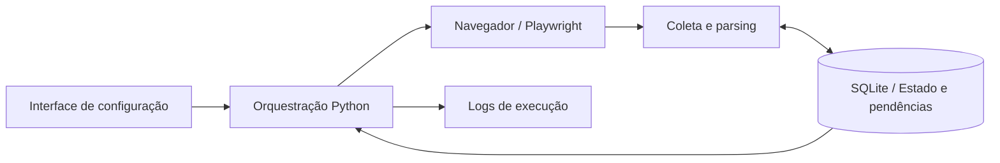

# Eproc Automação

### Automação assistida de rotinas e organização de processamento

**Python · Playwright · Beautiful Soup · SQLite · Interface desktop**

Ferramenta de automação assistida para rotinas relacionadas ao eproc. Combina navegação em navegador, coleta e tratamento de informações, acompanhamento de execução e persistência local para retomada de tarefas.

> Repositório de apresentação técnica, com código-fonte privado. Não contém processos reais, dados de pessoas, credenciais, cookies, capturas de sessões ou configurações dos ambientes utilizados.

## O problema

Rotinas repetitivas em sistemas web exigem navegação, conferência de informações e continuidade entre etapas. Quando uma execução é interrompida, repetir todo o trabalho aumenta o esforço e dificulta identificar o que já foi processado.

## A solução

- Navegação e interação com páginas por meio de Playwright.
- Separação entre coleta, parsing e acompanhamento da execução.
- Interface desktop para configuração, início da execução e visualização de logs.
- Persistência do estado e de pendências em SQLite.
- Registro de etapas já processadas e de falhas para permitir retomada.
- Empacotamento para execução em ambiente Windows.

## Arquitetura

## Decisões técnicas

- **Estado persistente:** tarefas pendentes permanecem registradas entre execuções.
- **Responsabilidades separadas:** navegação, coleta, parsing e persistência ficam em módulos distintos.
- **Automação assistida:** etapas de acesso dependem da autenticação e das verificações exigidas pelo sistema de destino.
- **Interface e execução separadas:** o configurador inicia o processamento e acompanha sua saída.
- **Configuração por ambiente:** parâmetros de acesso não são publicados nesta documentação.

## Stack

| Responsabilidade | Tecnologia |
| --- | --- |
| Orquestração e processamento | Python, asyncio |
| Navegação web | Playwright |
| Tratamento de HTML | Beautiful Soup, lxml |
| Estado e pendências | SQLite |
| Configuração | Variáveis de ambiente |
| Distribuição desktop | Empacotamento com PyInstaller |

## Limites e contexto

Este é um estudo de implementação de automação, sem vínculo oficial com os sistemas citados. Mudanças nas páginas e nos fluxos de acesso podem exigir manutenção dos seletores. A apresentação não disponibiliza acesso, não executa operações e não publica material de sessões autenticadas.

## O que esta apresentação demonstra

Orquestração de tarefas, integração com interfaces web, persistência de progresso e atenção à retomada de processamento em fluxos com múltiplas etapas.

**Projeto apresentado por [Nycolas França](https://github.com/Scorpped).**
